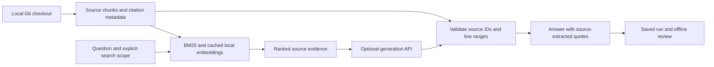

# RepoLens

**Explore a Python repository and get answers with verifiable file-and-line citations.**

RepoLens is a command-line RAG portfolio project. It combines local repository indexing, keyword and semantic retrieval, and optional API-generated answers. English is the default answer language; Simplified Chinese and question-language matching are explicit options.

[Watch the narrated English walkthrough](https://raw.githubusercontent.com/ychen3751/repolens/main/docs/media/RepoLens-Walkthrough.mp4) · [English subtitles](https://raw.githubusercontent.com/ychen3751/repolens/main/docs/media/RepoLens-English.srt)

## What works today

- Index tracked Python and Markdown files without executing repository code.
- Preserve file hashes, base commits, line ranges, and working-tree state.
- Compare BM25, local semantic retrieval, and reciprocal-rank hybrid search.
- Search the full repository or restrict questions to documentation with `--scope guide`.
- Generate answers through OpenAI, DeepSeek, or a compatible Chat Completions endpoint, using your own API key.
- Extract quotations from model-selected source ranges and validate their integrity.
- Save successful runs and review language, completeness hints, and citations offline.

This is a CLI prototype, not a hosted website or production service. Citation checks verify source references, not whether a claim logically follows from them. Independent held-out evaluation and a graphical interface are not implemented.

## Try the offline demo

Requires Python 3.10+ and Git for repository ingestion. Python 3.12 was used for the semantic experiments.

Run commands from this `repolens` directory:

```bash
python3 answer.py --demo
python3 answer.py --help
```

The demo is a clearly labeled, hand-authored synthetic example. It needs no API key, model download, or repository index; it is not a live AI answer.

## Index the example repository

The development corpus is [Click](https://github.com/pallets/click), pinned to a recorded commit. Keep its checkout outside this project.

```bash
git clone https://github.com/pallets/click.git /tmp/repolens-click
git -C /tmp/repolens-click checkout ac0e297ec2d7d78455a7d18ce306996e668c4a85
python3 ingest.py /tmp/repolens-click --syntax --output data/click-syntax.jsonl
python3 answer.py --preview "How do I test a command and inspect its output?" --scope guide
```

Preview retrieves actual evidence without a generation API call. The default retriever is BM25 and uses only the standard library. `--syntax` keeps function boundaries where possible, with bounded windows for long functions. Model files and indexes are excluded from Git; third-party source stays in its own checkout with its license.

## Local semantic and hybrid retrieval

```bash
python3 -m venv .venv
.venv/bin/python -m pip install -r requirements-semantic.lock.txt
.venv/bin/python answer.py --preview \
  "How do I test a command and inspect its output?" \
  --retriever hybrid --scope guide --top-k 3
```

The pinned dependency snapshot was tested on macOS ARM64 with Python 3.12; other platforms may need dependency adjustments. The first semantic run downloads the pinned MiniLM embedding model. Inference runs locally. Long inputs are partitioned into token-safe windows and pooled; original source citations remain unchanged. Document and query vectors have separate caches, so new questions do not re-encode unchanged documents.

## Choose an answer language

| Option | Answer prose |
|---|---|
| Omit `--language`, or use `--language en` | English, regardless of question language |
| `--language zh` | Simplified Chinese |
| `--language auto` | Ask the model to follow the question language |

CLI help, status messages, and documentation are English. Source quotations, paths, code identifiers, and JSON keys are preserved. Language is a model instruction, not a hard guarantee; review saved answers. The English embedding model and mostly English corpus have not been evaluated comprehensively for Chinese retrieval. Other languages are not explicitly tested.

## Choose your generation API

| CLI option | Export these environment variables | Model requirement |
| --- | --- | --- |
| `--provider openai` (default) | `OPENAI_API_KEY`, `OPENAI_MODEL` | Responses API with Structured Outputs |
| `--provider deepseek` | `DEEPSEEK_API_KEY`, `DEEPSEEK_MODEL` | DeepSeek chat model supporting JSON output and the thinking option |
| `--provider compatible` | `COMPATIBLE_API_KEY`, `COMPATIBLE_MODEL`, `COMPATIBLE_BASE_URL` | Chat Completions with bearer authentication, system messages and JSON-object output |

Use the key and model ID issued by your chosen provider. For a compatible endpoint, set its base URL (for example, `https://your-provider.example/v1`). RepoLens appends `/chat/completions`. Remote servers require HTTPS. After exporting the three compatible settings, try:

```bash
.venv/bin/python answer.py --live --provider compatible "How do I test a command and inspect its output?" --scope guide
```

### Reproduce the DeepSeek example in the walkthrough

Live generation sends your question and retrieved snippets to the selected provider and incurs API charges. Only use a corpus you are authorized to send. No provider credentials are included in this repository.

Run the following line, paste your key at the prompt, and press Enter:

```bash
read -r -s -p "DeepSeek API key: " DEEPSEEK_API_KEY
```

Then run:

```bash
export DEEPSEEK_API_KEY
export DEEPSEEK_MODEL=deepseek-flash
.venv/bin/python answer.py --live --provider deepseek \
  "How do I test a command and inspect its output?" \
  --retriever hybrid --scope guide --top-k 3 \
  --save-run data/answers/english-demo-01.json
```

To request Chinese, add `--language zh` and choose a different output filename. Existing records are not overwritten. Keys are read from exported environment variables; `.env` files are not loaded automatically. The blank `.env.example` lists settings and contains no credentials.

OpenAI is also supported: set `OPENAI_API_KEY` and `OPENAI_MODEL` to an accessible Responses/Structured Outputs model and use `--provider openai`. OpenAI remains the default provider if the flag is omitted. Requests go only to the selected provider.

## Review the answer

```bash
python3 quality.py --run data/answers/english-demo-01.json --case answer-01
```

The example question must match the selected review case. Only review a new file after the generation command confirms it was saved. The checker flags missing expected mentions and possible language mismatches. Correctness, citation support, and completeness require manual review.

A user-observed DeepSeek run with guide scope and explicit English successfully explained importing/creating `CliRunner`, invoking a command, and checking output and exit status, with source-derived citations. That is one development example, not an overall accuracy claim. See the [review rubric](evaluation/answers/REVIEW.md).

## Architecture



## Measured development results

Same 16 questions, full-repository scope, syntax chunks, and token-safe embeddings:

| Metric | BM25 | Semantic | Hybrid |
|---|---:|---:|---:|
| Hit@1 | 3/16 | 6/16 | 5/16 |
| Hit@3 | 8/16 | 7/16 | 7/16 |
| Hit@5 | 8/16 | 9/16 | 9/16 |
| MRR@5 | 0.3229 | 0.4313 | 0.3927 |

These are assistant-labeled development results, not independently reviewed test accuracy. Alternative valid evidence may be scored as a miss. No method wins on every metric. Guide-only experiments use a different candidate scope and must be reported separately.

```bash
.venv/bin/python compare.py
.venv/bin/python -m unittest discover -s tests -v
```

See the [comparison report](evaluation/retrieval-comparison-windowed.json), [guide-scope experiment](evaluation/guide-scope-comparison.json), and [full development history](docs/EXPERIMENTS.md). Earlier experiments and negative results are retained for reproducibility.

## Remaining work

- Independently review labels and reserve a held-out question set.
- Run the remaining answer-quality cases, including abstention and adversarial comments.
- Evaluate claim support separately from citation integrity.
- Build a graphical demo interface.
- Review secrets, artifacts, and dependency portability before publication.

The project has not been deployed. Publishing code does not grant others access to your model account; they must supply their own credentials for live generation.

## Demo and portfolio materials

- [Three-minute demo script](docs/DEMO.md).
- [Portfolio description and interview notes](docs/PORTFOLIO.md) — scoped claims and resume drafts.
- [Third-party notices](THIRD_PARTY_NOTICES.md) — attribution and license for Click excerpts.

Create an allowlisted source archive with `python3 scripts/package_release.py`.
It excludes local data, live-run files, model downloads, virtual environments, and secrets files. A limited pattern scan runs before packaging; review the resulting manifest before publishing. Original RepoLens code has no license selected yet; do not describe it as permissively licensed until a license is chosen.
